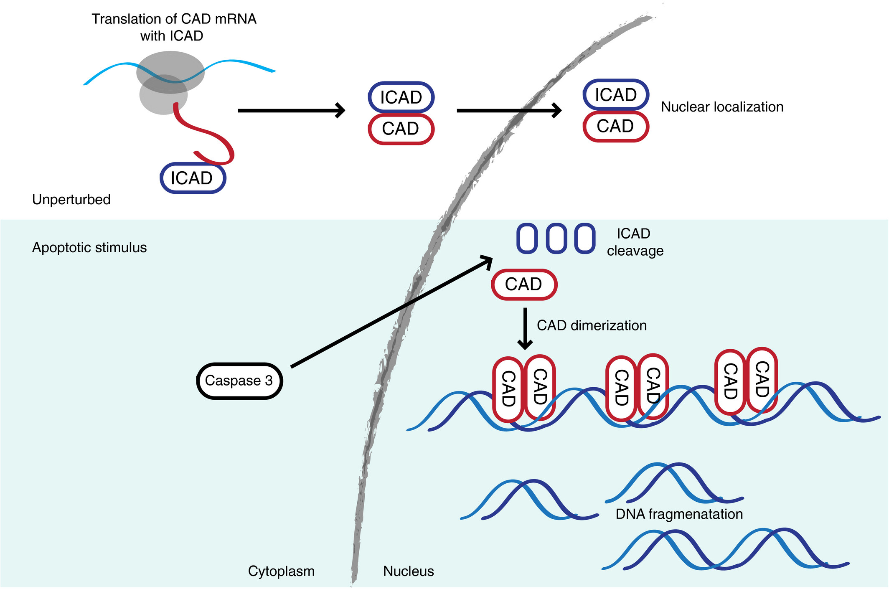

Tags: #CellBiology 

### General Concept
In general when controlling organ size/shape/function, you can control
- Proliferation
- Growth
- Function (Differentiation)
- **Cell death**

There are multiple mechanisms of cell death
- **Apoptosis** is the programmed cell death - A tightly regulated form of cell death, with orderly dismantlement
- **Necrosis** is the uncontrolled passive form of cell death, caused by injury  and characterized by a **loss of membrane** and release of intracellular contents that triggers **inflamation**

The morphological hallmarks of apoptosis
- Cell shrinkage and the membrane **blebbing**
- Condensation and fragmentation of chromatine
- Rapid *engulfment* of the *corpse* by macrophages

The physiological roles of apoptosis is to eliminate cells that aren't needed any more, or cells that can be detrimental to the organism
- When **shaping organs**, we can *sculp* the organ by removing cells (Michelangelo type beat)
- Development of the nervous system, where we form many neurons (a lot of redundant ones), that are removed through development - "**neuronal pruning**"
- **Adaptive** stress response
### Caspases
Cysteine-dependent Aspartate-specific proteases (**Caspases**) are a family of proteins that facilitate apoptosis. They are **proteases**, that use a **cysteine** residue in their active site to break down proteins (close to aspartic residues)
- **Initiator caspases** vil activate **executioner caspases** leading to **apoptosis**.

The **initiator caspases** are synthesized as inactive monomers (**procaspases**). Some **adaptor proteins** can **dimerize** the procaspases, which **autocleaves** and thus activates. The dimers each bend and cleaves, resulting in a **tetramer** with four subunits (two large and two small)
- **caspase-9** dimerized with **apaptosome** as adaptor
- **caspase-8** dimerized with **DISC complex** as adaptor

The active **executioner procaspases** are then cleaved in a similar manner **by the active initiator caspase**, and are thus activated. 
- **Caspase-3, -6, & -9** are all executioner caspases

The executioner caspases cleaves numerous structural and regulatory proteins (**mass proteolysis**) on proteins including
- **Lamin** proteins
- Structural proteins
- Cell cycle proteins

The DNA is degradated by the executioner caspaces activating Caspase Activated DNase (CAD). Normally, CAD is bound and inibited by iCAD. Upon the arrival of **Caspase 3** the **iCAD is cleaved** by it, releasing **CAD** which then cleaves the **linker-DNA** between the nucelosomes. 

The caspases also mediate changes in the plasma membrane to attract macrophages. 
- The **flippase**, is **inactivated** by **caspase 3**, meaning that flipped lipids wont be fixed
- The **scramblase**, which is inactivated in the plasma membrane in a normal cell, but during apoptosis the **caspase 3** will **activate** it, both of which results in a scrambled (symmetrical) membrane, which **attracts macrophages**

### Control Mechanics
There are two pathways for **activating caspases** - **intrinsic pathway** and the **extrinsic pathway**
#### Intrinsic pathway
This uses the **Bcl2 protein family** (Not to be confused with the Bcl2-*proper* protein) which includes both pro- and anti-apoptotic factors. The Bcl2 family is connected by the four (Bcl2 Homology domains) **BH domains**, that allow them to interact. 
- **Bcl2**, **BclXL** - These are **anti-apoptotic** proteins with all domains BH1, BH2, BH3 and BH4
- **Bax**, **Bak** - These are **pro-apoptotic** proteins with BH1, BH2, and BH3 domains
- **Bad**, **Bid**, **Bim**, **Puma**, **Noxa** - These are **pro-apototic** protein with BH1 only

Growth and survival factors suppress the apoptosis by the **PI-3 Kinase pathway** leading to the **active AKT** phosphorylating **Bad**, releasing Bcl2 to inhibit apoptoses.

**Bax** and **Bak** creates channels in the mitochondrial membrane, which makes the mitochondrial proteins in the **inter-membrane space** be released to the cytosol. 
- These channels can form in **Bax-Bax**, **Bak-Bak** and **Bax-Bak pairings**

One important protein in this aspect is **cytochrom c**, which binds to an adaptor protein and assembles in an **apoptosome** (adaptor protein) - thus recruiting and activating the initiator caspase **caspase-9**, initializeing a **caspase cascade** leading to apoptosis

**Bcl2 proteins** normally blocks the formation of the Bak/Bax channels in the mitochondria, but when the apoptotic stimulus is relayed by an activated **BH3 protein (Puma, Noxa)** this **inhibits the Bcl2** and allows the formation of the Bak/Bax channels

DNA damage can induce apoptosis through the **phosphorylation of p53**, which af course delays the S-phase by **enhancing transcription of p21**, but the active p53 also **up regulates NOXA and PUMA** - which begins the **intrinsic pathway** of apoptosis

All in all the balance between the activities of the pro- and anti-apoptotic proteins determines the cells survival in the intrinsic pathway.

#### Extrinsic pathway
This pathway is activated by **Fas ligands** bound to the membrane of a killer lymphocyte for example, which activates the **Fas death receptors**.
- These bind intracellularly to the **FADD adaptor proteins**, which form the **DISC complex** with **pro-caspase-8**, dimerizing and cleaving the caspases to activate **caspase-8**, which initiates apoptosis by activating executioner caspases launching a **caspase cascade**.
